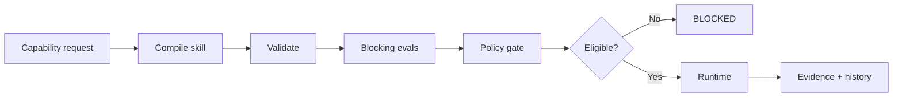

# Skillaryx

**Compile intent into agent capability.**

Skillaryx is an early-stage control layer for reusable AI agent capabilities.

> Prompts are instructions. Skills are operational assets.

Website: https://skillaryx.com  
Contact: founder@skillaryx.com

## Why this exists

Agent capabilities often live as scattered prompts, scripts, and implicit permissions. Skillaryx explores a stricter model: package a capability, validate it, evaluate it, apply policy, and only then allow runtime execution.

## Capability lifecycle



## Working local prototype

The V0.1 prototype has been verified locally on Windows for:

- versioned skill packaging
- schema and contract validation
- explicit permission checks
- blocking evaluations
- policy-gated execution
- deterministic MOCK runtime
- PASS and BLOCKED execution paths
- persistent run history

The public website includes screenshots of the local prototype.

## Public repository scope

This is intentionally a **small public project footprint**, not the complete product codebase. It documents the product model and includes a safe example skill that can be inspected without exposing private implementation details or credentials.

```text
.
├── docs/
│   ├── ARCHITECTURE.md
│   ├── SKILL_PACKAGE.md
│   └── STATUS.md
├── examples/
│   └── release-auditor/
├── CHANGELOG.md
├── ROADMAP.md
├── SECURITY.md
└── LICENSE
```

## Example skill

`examples/release-auditor` models a capability that audits a Python project before production deployment.

Its constraints intentionally demonstrate the core philosophy:

- never deploy anything
- read only inside the approved project path
- run only allowlisted commands
- deny unrestricted network access
- block execution when a required check fails
- return concise evidence

## Provider status

The private prototype includes a Claude runtime adapter as a **planned first live provider path**. This repository does **not** claim that a live Claude API execution has already been verified.

## Project status

Early-stage · bootstrapped · founded 2026 · working local prototype.

See [docs/STATUS.md](docs/STATUS.md) for a precise split between working, implemented, planned, and not-claimed capabilities.

## Security

Please read [SECURITY.md](SECURITY.md) before reporting a security issue. Never post credentials or sensitive exploit details in a public issue.

## License

The public materials in this repository are released under the MIT License.
